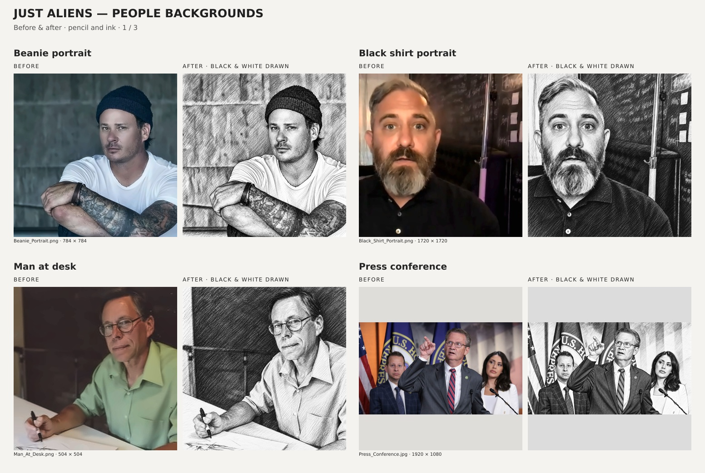
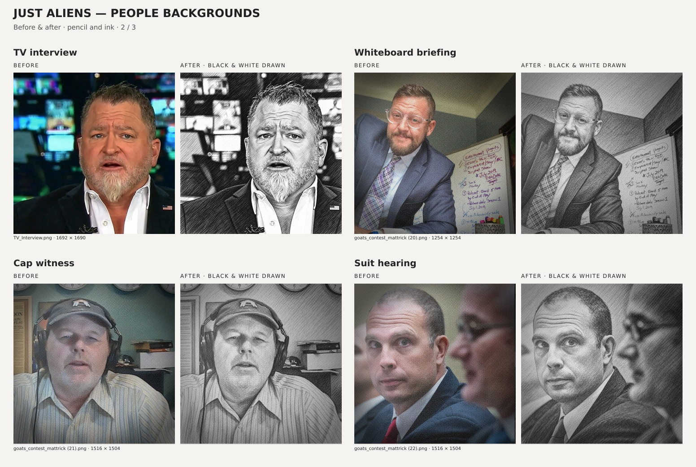
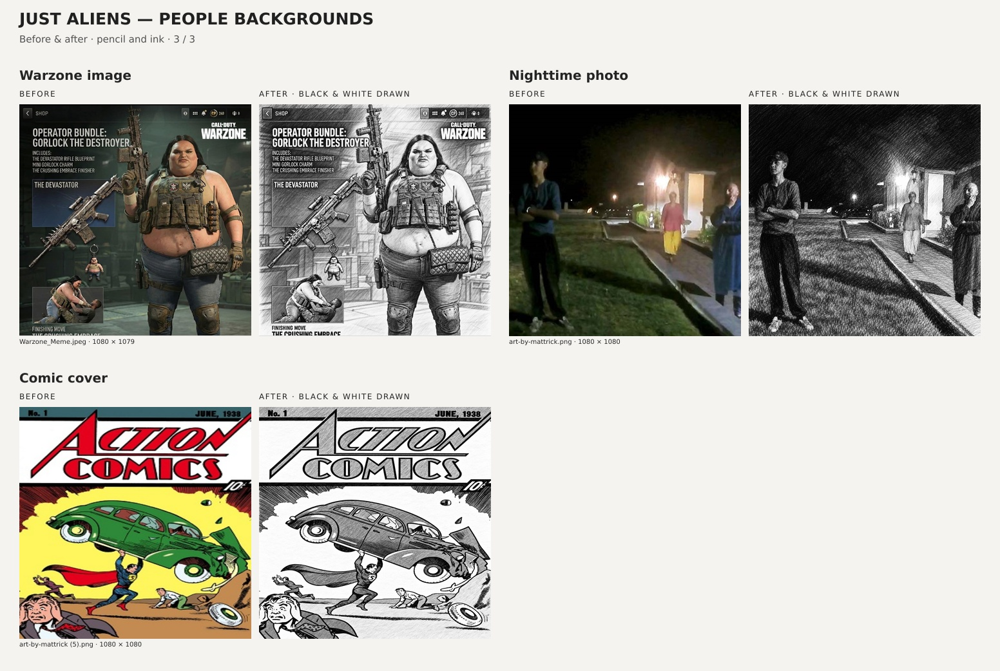

# People backgrounds — before and after

Eleven backgrounds containing people use a black-and-white pencil-and-ink treatment. This includes eight portrait/press backgrounds, the nighttime photo, the Warzone image, and the comic cover. The updated files keep the filenames used by the collection generator, their original canvas dimensions, and their original alpha channels.

The original color files remain available at [commit f1dac810](https://github.com/DOGECOIN87/JUST_ALIENS_NFT_COLLECTION/tree/f1dac8100b373dc8291c93b37d1aa2c10447ce2a/Assets). All 64 backgrounds without people remain byte-for-byte unchanged.

## Comparisons

Each pair places the original on the left and the drawn version on the right. Images are fitted without cropping; gray bars only belong to the review layout.







## Individual comparisons

| Background | Before and after |
| --- | --- |
| Beanie portrait | [Full size](pairs/beanie.jpg) |
| Black shirt portrait | [Full size](pairs/black-shirt.jpg) |
| Man at desk | [Full size](pairs/desk.jpg) |
| Press conference | [Full size](pairs/press.jpg) |
| TV interview | [Full size](pairs/tv.jpg) |
| Whiteboard briefing | [Full size](pairs/whiteboard.jpg) |
| Cap witness | [Full size](pairs/cap.jpg) |
| Suit hearing | [Full size](pairs/hearing.jpg) |
| Warzone image | [Full size](pairs/warzone.jpg) |
| Nighttime photo | [Full size](pairs/night.jpg) |
| Comic cover | [Full size](pairs/comic.jpg) |

## Treatment and validation

The built-in imagegen tool applied the drawing style. [prompts.md](prompts.md) records the prompt for every asset. The outputs were normalized to true grayscale at each source canvas size. The original alpha values were restored. PNGs remain lossless PNGs; the two JPEG source files remain JPEGs with grayscale encoding at quality 100.

For the three enhanced people backgrounds, the supplied `Assets/halftone_grayscale.png` is reapplied at 30% opacity with the existing smooth corner vignette reaching 45%. These settings match the other enhanced backgrounds.

The asset manifest in `Assets/people-backgrounds-manifest.json` records the original commit, source/output SHA-256 hashes, dimensions, and texture settings. [verification.json](verification.json) records checks for true grayscale, matching dimensions, unchanged alpha, and all 64 other backgrounds remaining unchanged.

Rebuild the comparison sheets and verify the committed assets with:

```sh
npm run people-background-review
```

The original commit must be present locally. For a shallow checkout that lacks it, fetch it before running the command:

```sh
git fetch origin f1dac8100b373dc8291c93b37d1aa2c10447ce2a
```
